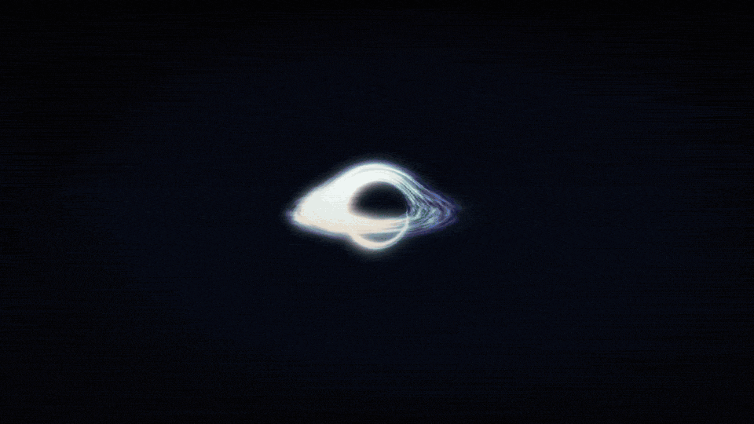
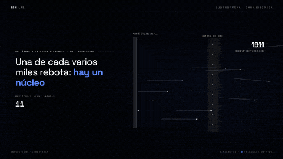
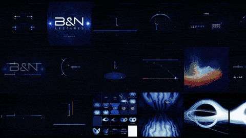

  

  <a href="https://bnsolutions.cl/lectures"><b>bnsolutions.cl/lectures</b></a> &nbsp;·&nbsp;
  <!-- TODO: reemplazar por el enlace del canal de YouTube cuando esté publicado -->
  <a href="TODO-canal-youtube"><b>Canal de YouTube</b></a> &nbsp;·&nbsp;
  <a href="https://bnsolutions.cl"><b>B&N Solutions</b></a> &nbsp;·&nbsp;
  <a href="README.en.md">Read in English</a>

B&N Lectures son clases animadas de matemática, física, computación, caos y geometría, hechas por B&N Solutions. Cada video está programado de punta a punta: las escenas son funciones del tiempo, las simulaciones resuelven la física de verdad y cada cifra que aparece en pantalla se calcula en el mismo cuadro.

Todo el código es abierto. Este repositorio es el punto de partida: explica el proyecto y enlaza a los tres repositorios donde vive cada parte.

### `// 01` Los repositorios

<table>
  <tr>
    <td width="33%" valign="top"> <a href="https://github.com/4mser/bn-lectures-clases"><b>bn-lectures-clases</b></a> Las clases, ordenadas por carrera y ramo. Parte con las seis de Electricidad y Magnetismo, los apuntes en que se basan y la plantilla para crear clases nuevas.</td>
    <td width="33%" valign="top"> <a href="https://github.com/4mser/bn-lectures-teaser"><b>bn-lectures-teaser</b></a> El teaser de 93 segundos en 4:5, 16:9 y 9:16: motor en canvas y WebGL2, simulaciones precalculadas y cada corte anclado a la canción.</td>
    <td width="33%" valign="top"> <a href="https://github.com/4mser/bn-lectures-biblioteca"><b>bn-lectures-biblioteca</b></a> El catálogo de las 192 simulaciones y efectos de los videos de B&N, con su ecuación, su origen y siete módulos listos para reutilizar.</td>
  </tr>
</table>

### `// 02` Cómo se hace una clase

| | |
|---|---|
| **Un guion que manda** | Cada clase parte de un guion escrito frase por frase. La voz se genera desde ese texto y entrega el momento exacto de cada palabra; las animaciones se anclan a esas palabras, así que si el guion cambia, la clase se reacomoda sola. |
| **Física calculada en el cuadro** | Las líneas de campo se integran, las fuerzas se suman y las constantes salen de CODATA. Lo que se ve en pantalla es el resultado de la cuenta, no un dibujo aproximado. |
| **Tres formatos, una sola clase** | `Clase` (4:5), `ClaseYT` (16:9) y `ClaseTT` (9:16) comparten escenas, voz y tiempos. Cambia solo cómo se reparte cada cuadro. |
| **Basada en apuntes reales** | La serie de Electricidad y Magnetismo sigue los apuntes y demostraciones de Javier Patiño, sección por sección, y se publica junto a ellos. |
| **Reproducible** | Cada cuadro es una función del tiempo. Se puede renderizar cualquier cuadro suelto, en cualquier orden y en paralelo, y sale igual. |

### `// 03` La serie de Electricidad y Magnetismo

Seis clases en orden, de la carga eléctrica a las distribuciones continuas.

| # | Clase | De qué trata | Video |
|---|---|---|---|
| 1 | [Del ámbar a la carga elemental](https://github.com/4mser/bn-lectures-clases/tree/main/clases/fisica/electricidad-y-magnetismo/01-del-ambar-a-la-carga-elemental) | La historia de la carga, de Tales a Millikan | `TODO` |
| 2 | [La ley de Coulomb](https://github.com/4mser/bn-lectures-clases/tree/main/clases/fisica/electricidad-y-magnetismo/02-la-ley-de-coulomb) | La balanza de torsión, la ley y la superposición | `TODO` |
| 3 | [El campo eléctrico y sus líneas](https://github.com/4mser/bn-lectures-clases/tree/main/clases/fisica/electricidad-y-magnetismo/03-el-campo-electrico-y-sus-lineas) | De la acción a distancia a las líneas de Faraday | `TODO` |
| 4 | [Una carga en un campo](https://github.com/4mser/bn-lectures-clases/tree/main/clases/fisica/electricidad-y-magnetismo/04-una-carga-en-un-campo) | Una carga suelta en un campo uniforme, comparada con la caída libre | `TODO` |
| 5 | [De lo discreto a lo continuo](https://github.com/4mser/bn-lectures-clases/tree/main/clases/fisica/electricidad-y-magnetismo/05-de-lo-discreto-a-lo-continuo) | Las seis demostraciones de campos conocidos | `TODO` |
| 6 | [Densidades no uniformes](https://github.com/4mser/bn-lectures-clases/tree/main/clases/fisica/electricidad-y-magnetismo/06-densidades-no-uniformes) | Dos ejercicios guiados con densidad variable | `TODO` |

### `// 04` Equipo

B&N Lectures lo hacen tres personas.

| | |
|---|---|
| **Nicolás Moreno** [@4mser](https://github.com/4mser) | Cofundador de B&N Solutions e ingeniero de software. Desarrolla el motor de animación, las simulaciones y los videos. |
| **Benjamín Campos** [@B3njjaman](https://github.com/B3njjaman) | Cofundador de B&N Solutions e ingeniero físico. Creó el reel original de la serie y su motor de simulación. |
| **Javier Patiño** | Licenciado en Física y profesor de Electricidad y Magnetismo. Autor de los apuntes en que se basan las clases y la voz de B&N Lectures. |

### `// 05` Licencia

El código y la documentación de los cuatro repositorios están bajo la [licencia MIT](LICENSE), © 2026 B&N Solutions.

Quedan fuera de MIT el nombre B&N Solutions, la marca y el logo B&N y el nombre «B&N Lectures», que siguen siendo de B&N Solutions ([TRADEMARKS.md](TRADEMARKS.md)). Los apuntes y demostraciones de Javier Patiño tienen su propia licencia, indicada en su carpeta de `bn-lectures-clases`. La música del teaser no se redistribuye.

---

  

